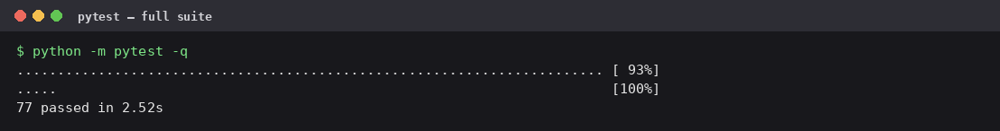
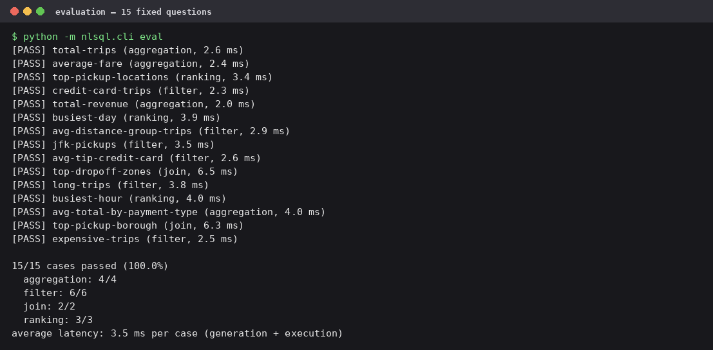
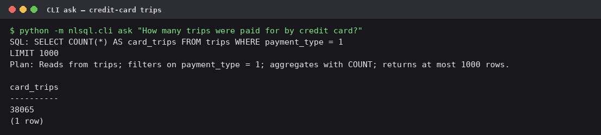
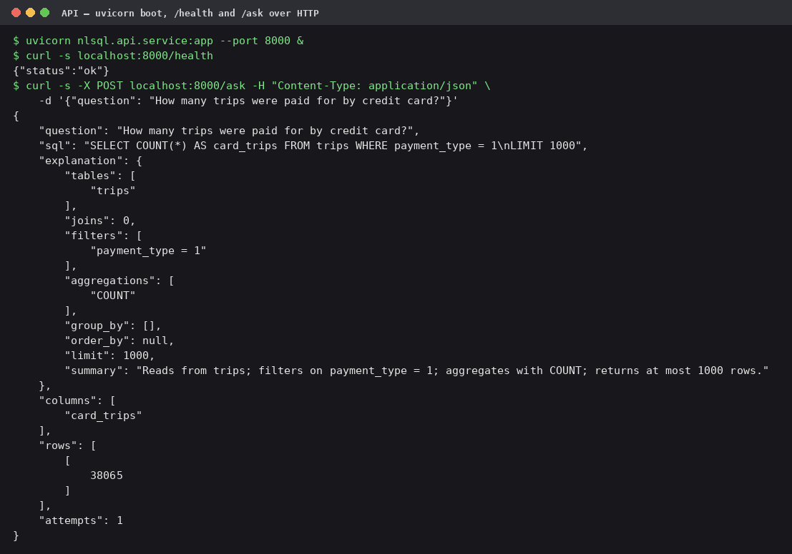

# Validation

The final checks, run against the finished code on 2026-11-06. This file
is evidence, not a setup guide: every number the README quotes comes from
one of these runs. Each image is the real terminal output of the command
shown, captured as it happened.

## 1. The full test suite

77 tests, all passing, all offline. This is the gate I trust day to day:
loader against the real sample, one rejection test per guardrail
category, the retry loop recovering from staged failures, the explainer,
the HTTP endpoints, the CLI's exit codes, and the evaluation harness
itself — including sabotage cases where a wrong or dangerous answer must
make the harness fail.

## 2. The evaluation set

15 of 15 fixed questions pass — aggregation 4/4, filter 6/6, join 2/2,
ranking 3/3 — grading first attempts only, result sets compared against
hand-written reference queries. Average latency landed at 3.5 ms per
case in this run; across repeats on this machine it sits between about
3.5 and 6 ms depending on load. That's the offline client, so the number
measures the pipeline, not a network call.

## 3. One question through the CLI

The credit-card question, end to end: the model side writes the SQL, the
guardrail appends the row cap (`LIMIT 1000`), the explainer summarises
the plan in plain English, and DuckDB returns 38,065 — the same number
the evaluation's reference query produces.

## 4. The API, booted for real

Not just the test client: uvicorn serving the app, `/health` answering
over HTTP, and a real `POST /ask` returning the same 38,065 with
`attempts: 1` and the explanation object. The service and the CLI are
the same pipeline; this is the check that proves it.
